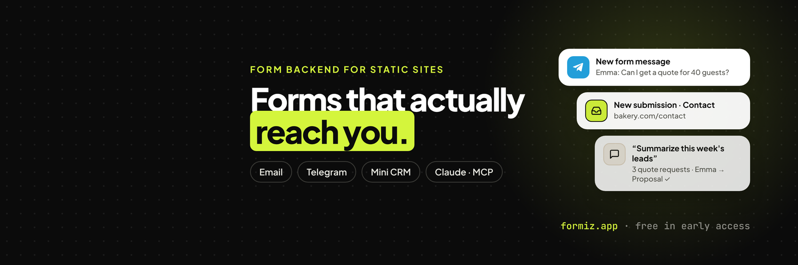

# Next.js contact form with no backend (Formiz)

A working contact form for Next.js, with **no API route, no server and no SMTP setup**. Submissions are delivered to your **email** and **Telegram** by [Formiz](https://formiz.app), and saved in a small built-in CRM.



## Why

Static and serverless sites (Next.js on Vercel, Netlify, GitHub Pages…) have no mail server. The usual options are writing an API route, configuring SMTP, or paying for a heavy form tool. This example shows the simplest way: post the form to one URL.

## Quick start

```bash
git clone https://github.com/loc0w/formiz-nextjs-contact-form
cd formiz-nextjs-contact-form
npm install
cp .env.example .env.local   # paste your access key
npm run dev
```

1. Create a free account at **[formiz.app](https://formiz.app)** and copy your project's access key.
2. Put it in `.env.local` as `NEXT_PUBLIC_FORMIZ_KEY`.
3. In the Formiz dashboard, add your email under **Channels** (and Telegram if you like).
4. Submit the form at `http://localhost:3000`. The message arrives in seconds.

## How it works

The whole integration is one `fetch` call in [`app/ContactForm.jsx`](app/ContactForm.jsx):

```js
await fetch('https://api.formiz.app/submit', {
  method: 'POST',
  headers: { Accept: 'application/json' },
  body: new FormData(form), // includes the hidden access_key field
});
```

Prefer plain HTML? This works too, with a redirect to a thank-you page:

```html
<form action="https://api.formiz.app/submit" method="POST">
  <input type="hidden" name="access_key" value="YOUR_ACCESS_KEY">
  <input name="name" required>
  <input name="email" type="email" required>
  <textarea name="message"></textarea>
  <button>Send</button>
</form>
```

## Useful fields

| Field | What it does |
| --- | --- |
| `access_key` | Your Formiz project key (required) |
| `subject` | Subject line of the notification email |
| `redirect` | URL to send visitors to after a plain HTML submit |
| `_honey` | Honeypot checkbox; submissions with it filled are dropped as spam |

Any other field (`name`, `email`, `message`, `phone`, …) is delivered as is. If you have a field named `email`, **Reply** in the notification email goes straight to the visitor.

## Features you get

- Email and Telegram notifications (WhatsApp coming soon)
- Spam protection: honeypot + rate limiting, optional domain allow list
- A tiny CRM: stages (New → Contacted → Proposal → Won/Lost), assignees, notes, CSV export
- Ask Claude about your submissions through the Formiz MCP connector

## License

MIT. Use it in any project.
